# Screenshots: before and after the mobile pass

Full-page Playwright captures of every page at 375, 390 and 768px, named `<page>-<width>.png`. `before/` was taken on 2026-10-20 before any UI change (master at f3f855d); `after/` after the step 2 mobile work on `midna/v2`. Both run against a local `next start` on the fake data from `scripts/seed-local.ts`. The after set's day view also has one extra pre-Fajr event (Qiyam al-Layl) that the seed gained, to show events before Fajr are kept.

Re-shoot with:

```bash
bun scripts/seed-local.ts file:/tmp/ucscmsa/audit.db > /tmp/ucscmsa/seed.json
# build and start with TURSO_DATABASE_URL=file:/tmp/ucscmsa/audit.db (never .env.local, which is production)
bun scripts/screenshots.ts --base http://localhost:3100 --out docs/screenshots/after --seed /tmp/ucscmsa/seed.json
```

## 390px, before → after

| Page | Before | After |
|---|---|---|
| Landing | 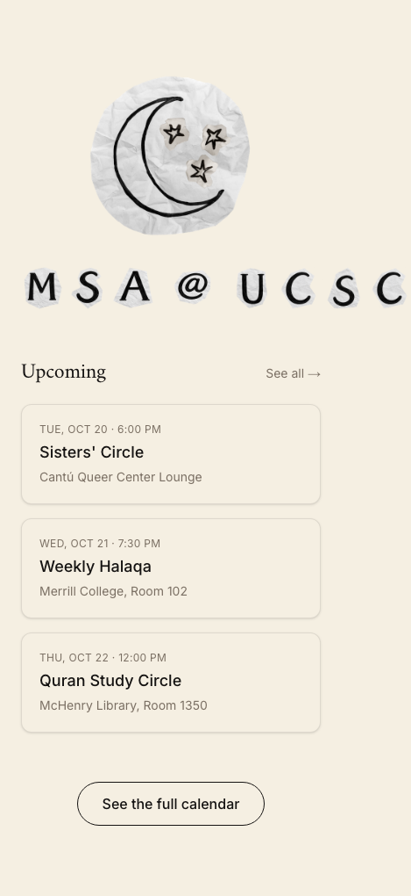 | 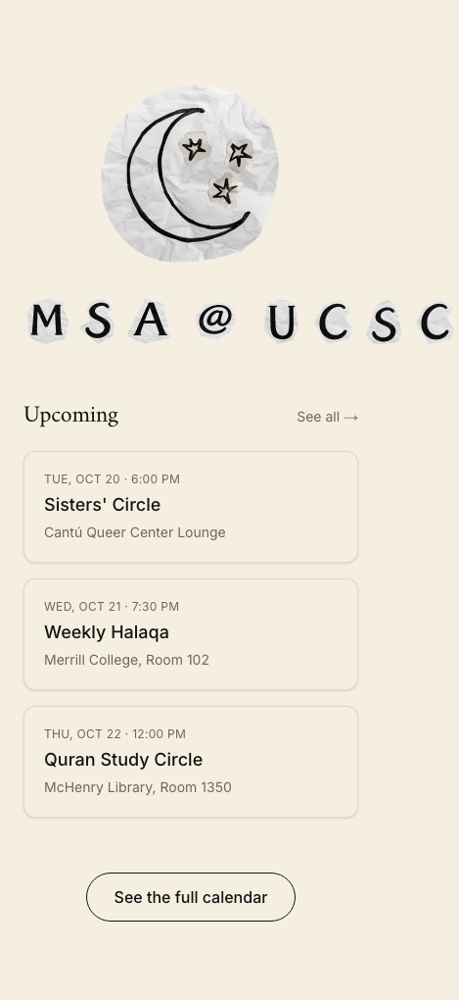 |
| Calendar — day (Fri Oct 23) | 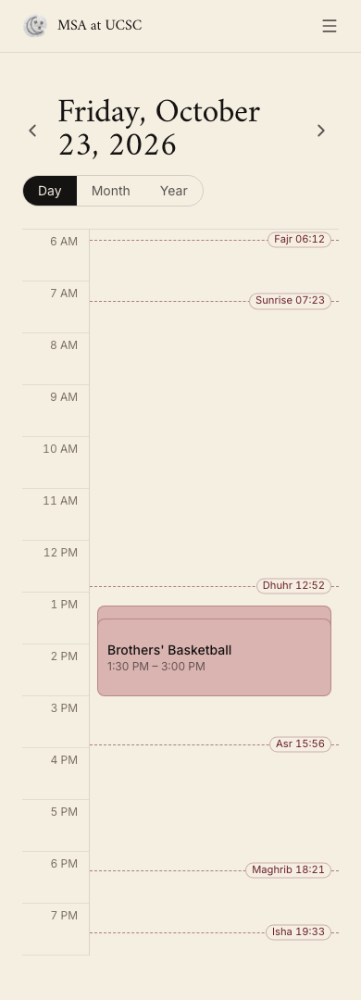 | 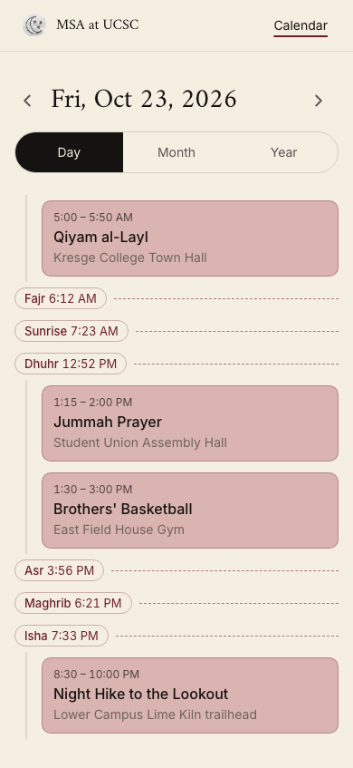 |
| Calendar — month (Oct 2026) | 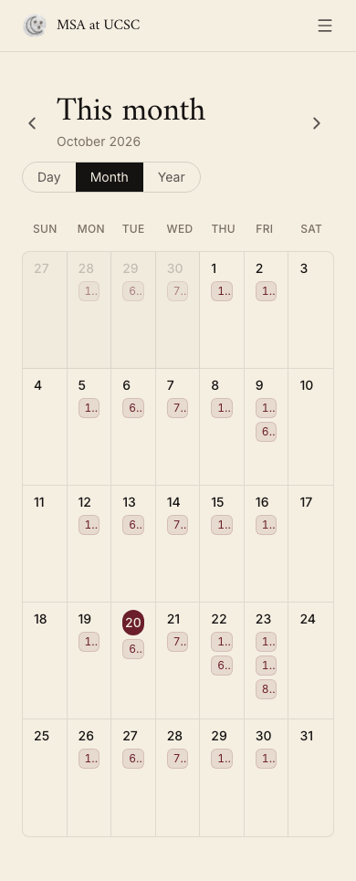 | 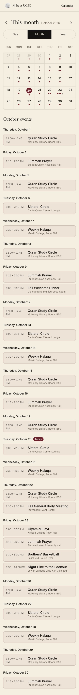 |
| Calendar — year (2026) | 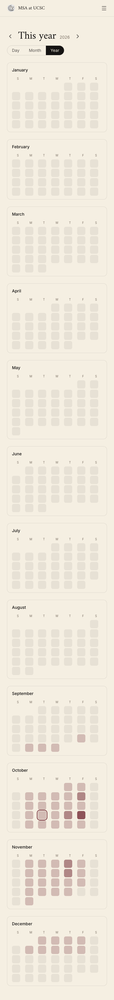 | 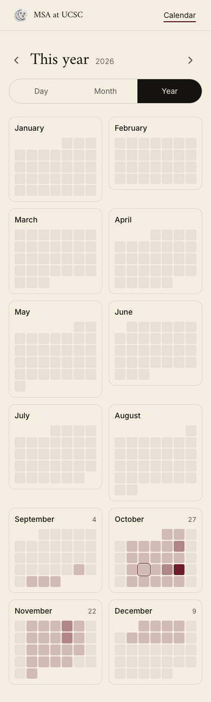 |
| Event (one-off) | 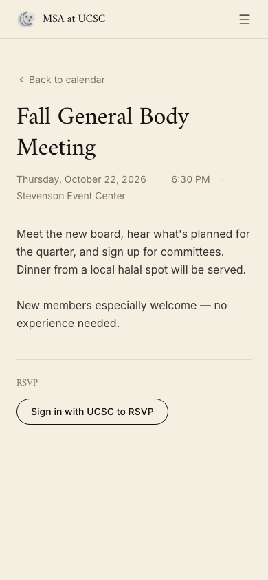 | 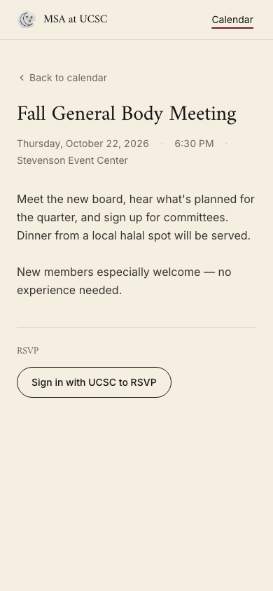 |
| Event (recurring) | 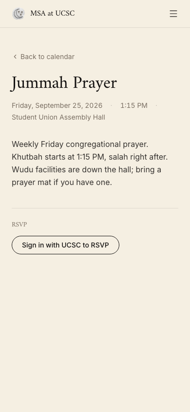 | 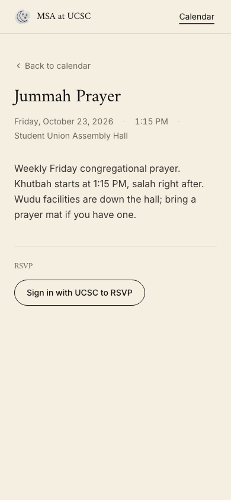 |
| Event, signed in (RSVP) | 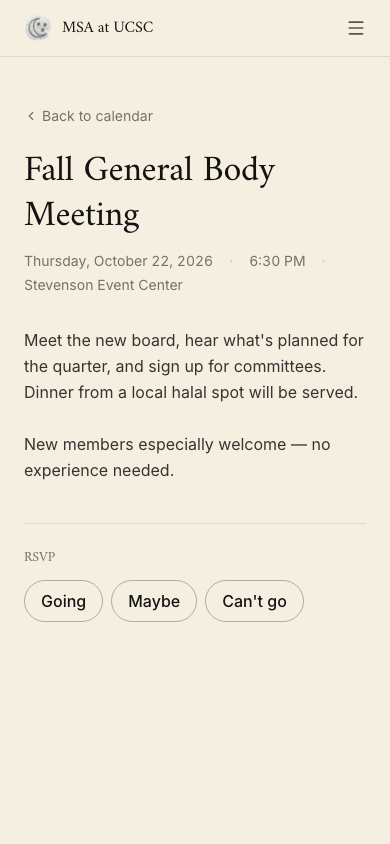 | 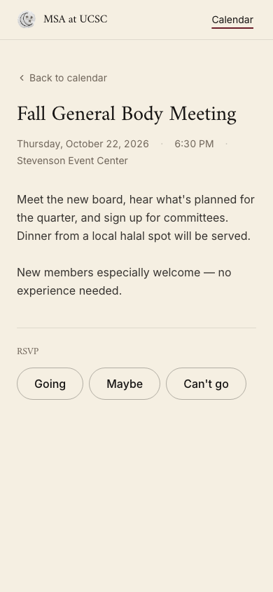 |
| Login | 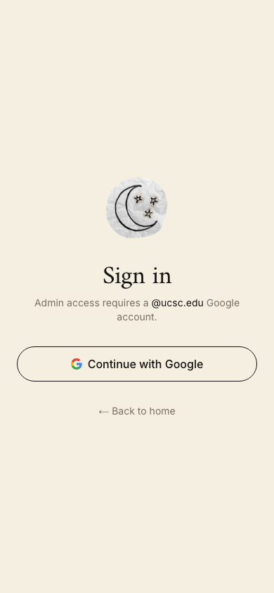 |  |
| 404 | 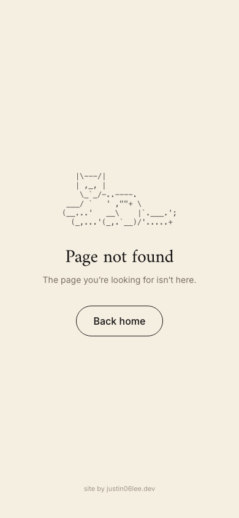 | 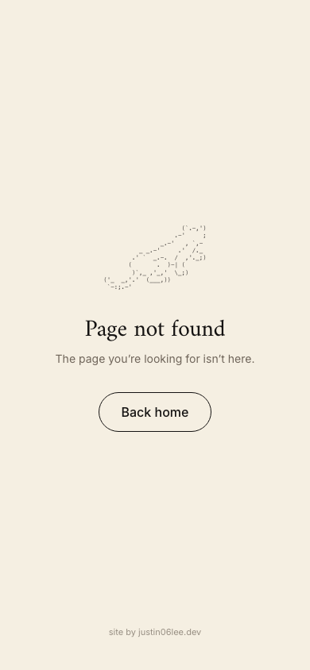 |
| Admin — events | 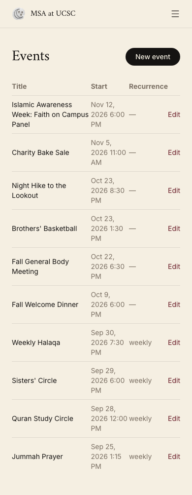 | 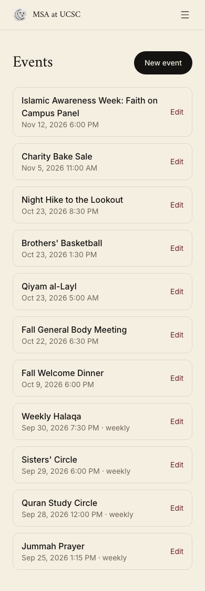 |
| Admin — new event | 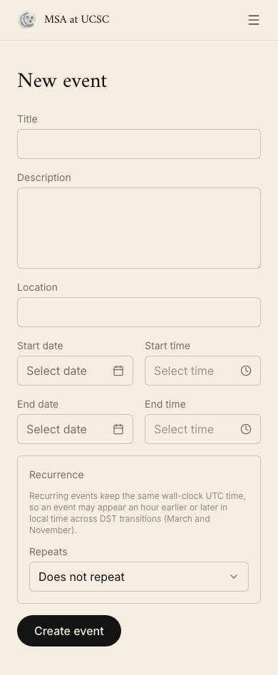 | 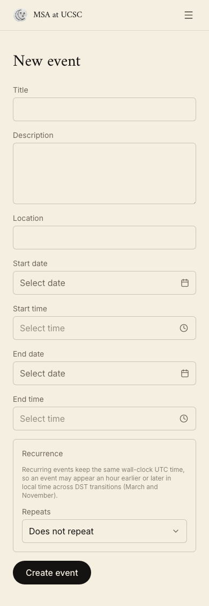 |
| Admin — edit event | 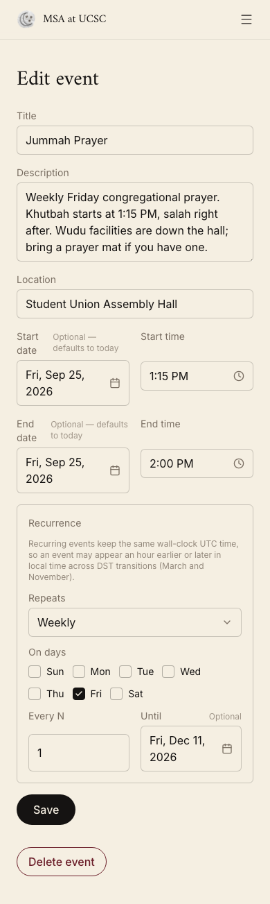 | 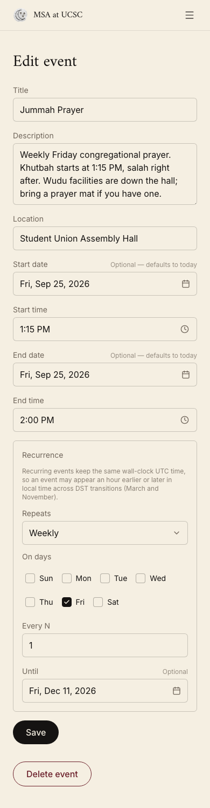 |
| Admin — admins | 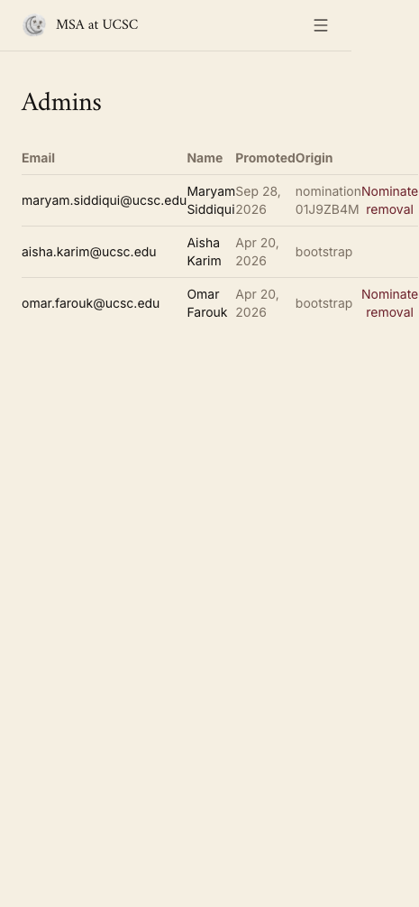 |  |
| Admin — nominations | 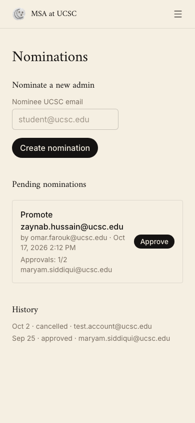 |  |

375 and 768px pairs have the same names in `before/` and `after/`.
