# Screenshots: before and after the mobile pass

Full-page Playwright captures of every page at 375, 390 and 768px, named `<page>-<width>.png`. `before/` was taken on 2026-10-20 before any UI change (master at f3f855d); `after/` after the step 2 mobile work on `midna/v2`. Both run against a local `next start` on the fake data from `scripts/seed-local.ts`. The after set's day view also has one extra pre-Fajr event (Qiyam al-Layl) that the seed gained, to show events before Fajr are kept.

Re-shoot with:

```bash
bun scripts/seed-local.ts file:/tmp/ucscmsa/audit.db > /tmp/ucscmsa/seed.json
# build and start with TURSO_DATABASE_URL=file:/tmp/ucscmsa/audit.db (never .env.local, which is production)
bun scripts/screenshots.ts --base http://localhost:3100 --out docs/screenshots/after --seed /tmp/ucscmsa/seed.json
```

## 390px, before → after

| Page | Before | After |
|---|---|---|
| Landing |  |  |
| Calendar — day (Fri Oct 23) |  |  |
| Calendar — month (Oct 2026) |  |  |
| Calendar — year (2026) |  |  |
| Event (one-off) |  |  |
| Event (recurring) |  |  |
| Event, signed in (RSVP) |  |  |
| Login |  |  |
| 404 |  |  |
| Admin — events |  |  |
| Admin — new event |  |  |
| Admin — edit event |  |  |
| Admin — admins |  |  |
| Admin — nominations |  |  |

375 and 768px pairs have the same names in `before/` and `after/`.

# v3 site upgrade: flyers, links, add to calendar

`before-v3/` is the site just before the v3 upgrade, at 375, 390 and 768px, named `<page>-<width>.png` like the sets above.

- **Public pages:** taken from the LIVE site, https://ucscmsa.com, on 2026-10-21 at about 14:28 PT, read-only (GETs, signed out). That was master `0feaa92`, minutes before the times release (`91244a0`) went live. They show the real events: Sisters' Game Night, Laser Tag + Arcade Social, and the Jummah series.
- **Admin pages:** from a local `next start` of `91244a0` on `scripts/seed-local.ts` data, since production admin needs a real sign-in.

`after-v3/` is the same pages once v3 shipped, with the same names:

- **Public pages:** from the LIVE site on 2026-10-21 at about 19:03 PT, read-only, the same way: master `875e85f` (Release 2, v3 from `midna/v3` `65700fb`, plus the board release), after MSA sync attached flyers to 63 events. Sisters' Game Night was under way, so it still shows its RSVP button.
- **Admin pages:** from a local `next start` of `65700fb` on `scripts/seed-local.ts` data, as before; the edit page now has the Links and Flyers sections.

| Page | Before (390px) | After (390px) |
|---|---|---|
| Landing | 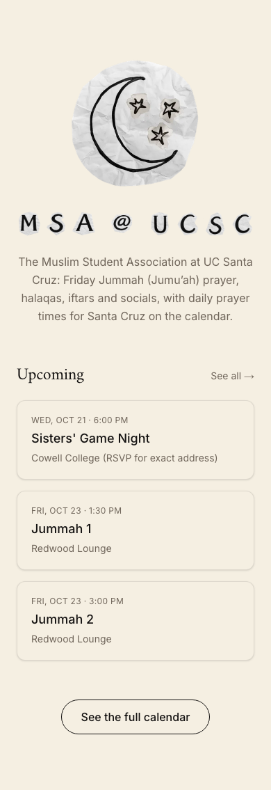 | 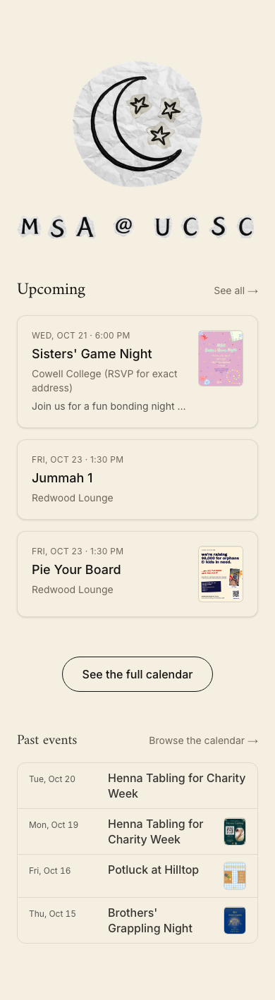 |
| Calendar — today (Wed Oct 21) | 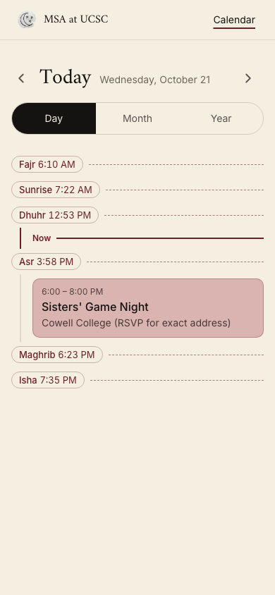 | 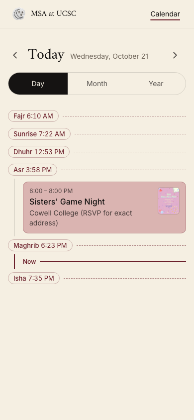 |
| Calendar — day (Fri Oct 23) | 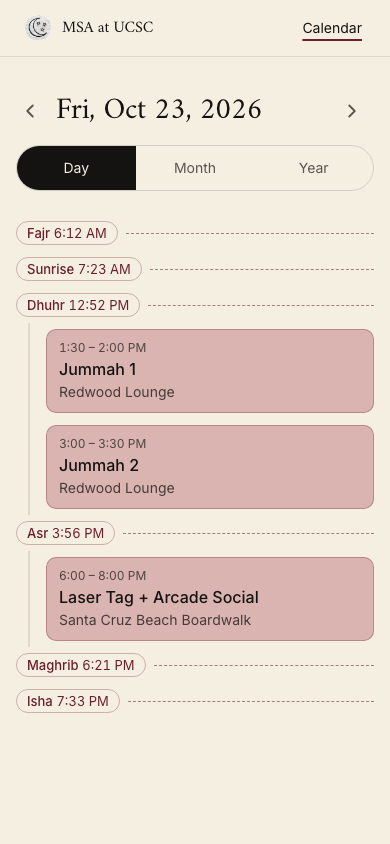 | 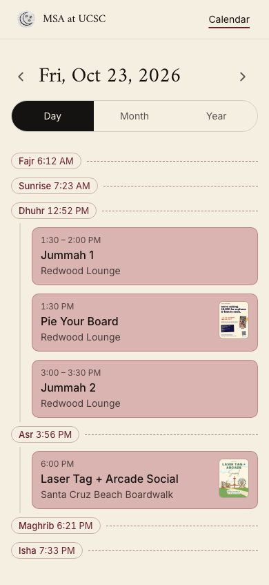 |
| Calendar — month (Oct 2026) | 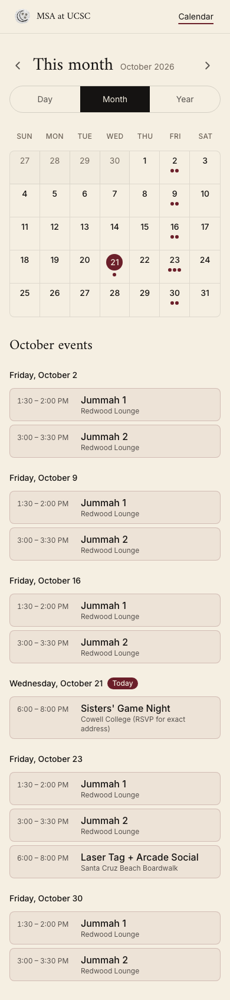 | 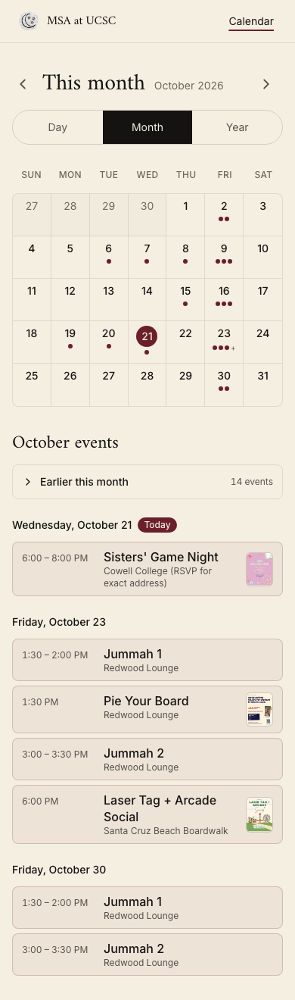 |
| Calendar — year (2026) | 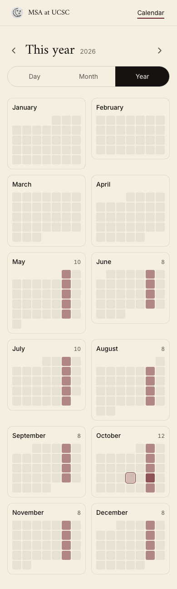 | 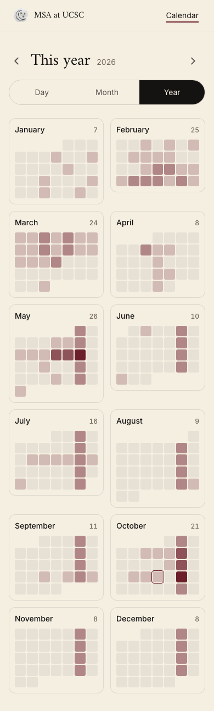 |
| Event — Sisters' Game Night | 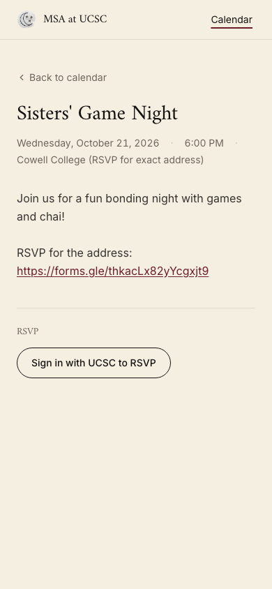 | 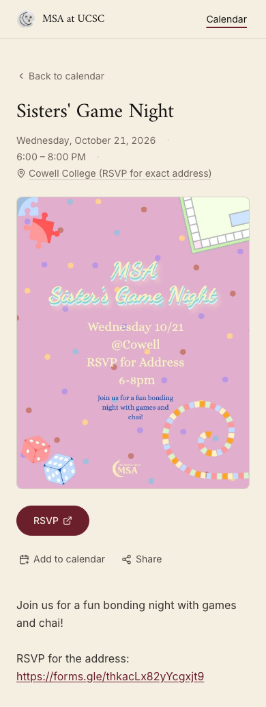 |
| Event — Laser Tag + Arcade Social | 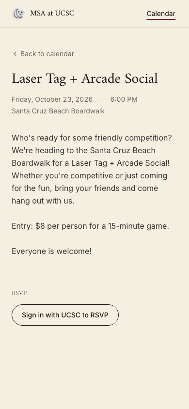 | 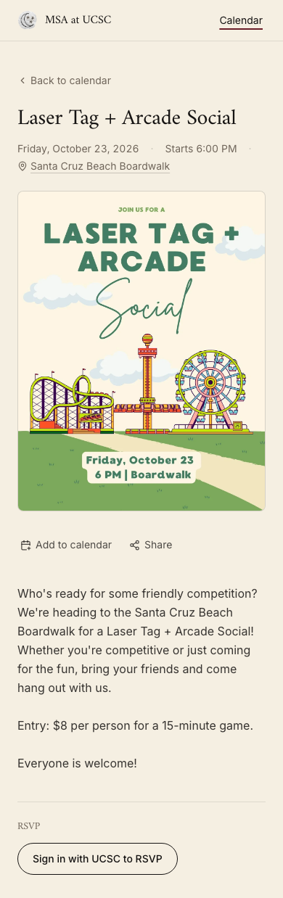 |
| Event — Jummah 1 (weekly) | 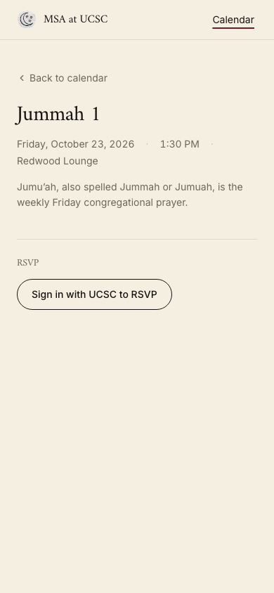 | 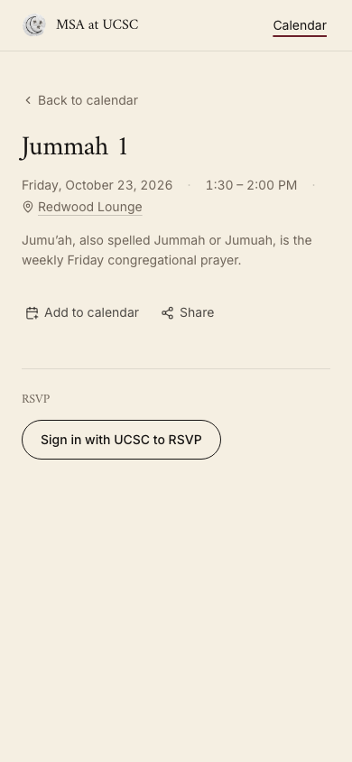 |
| Login | 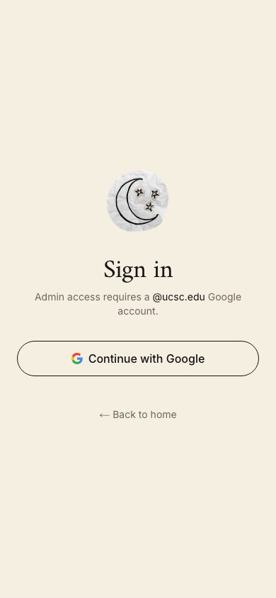 |  |
| 404 | 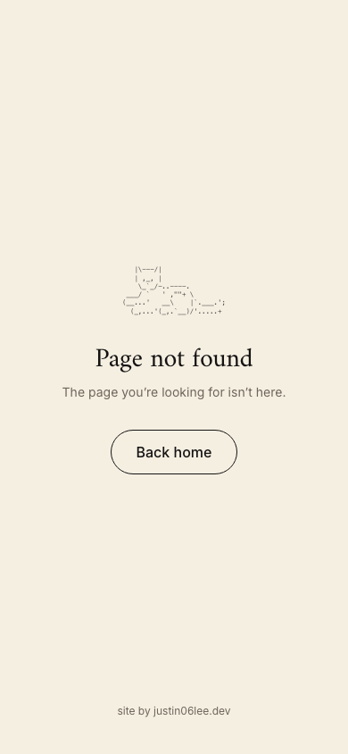 | 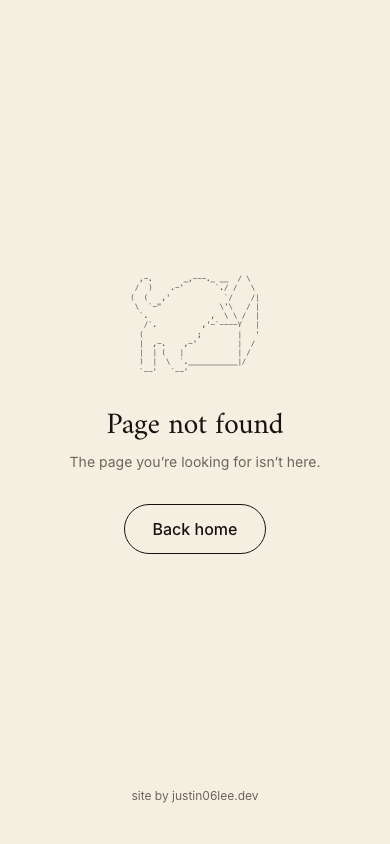 |
| Admin — events (seed) | 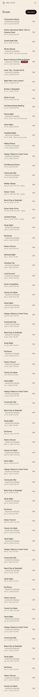 |  |
| Admin — new event (seed) | 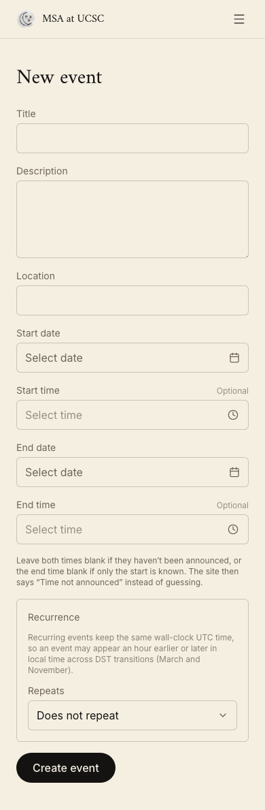 | 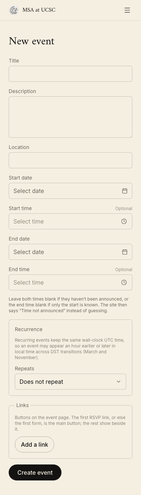 |
| Admin — edit event (seed) | 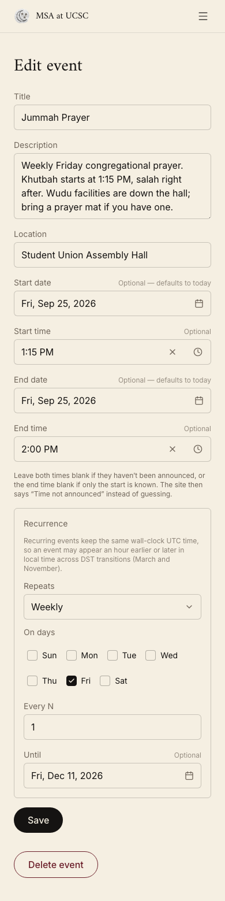 | 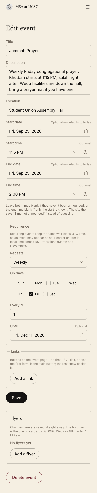 |
| Admin — admins (seed) |  | 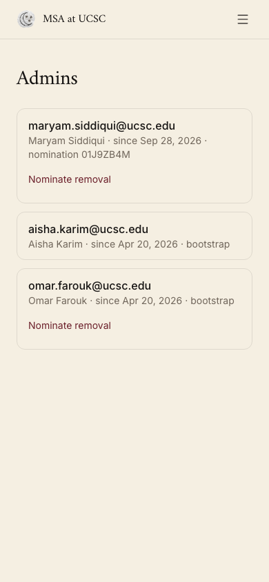 |
| Admin — nominations (seed) | 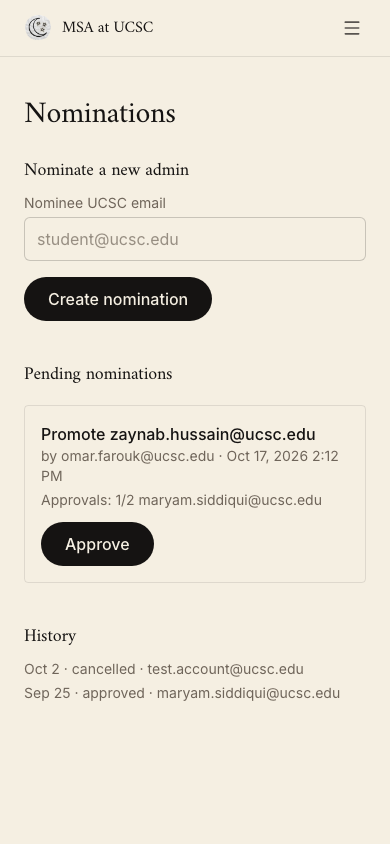 |  |
